# Lab 01 — Network Packet Sniffer (Python Raw Sockets)

*Course: Network and Internet Security (CySE 228) — Department of Cyber Security Engineering, University of Frontier Technology, Bangladesh*

---

## 1. Introduction

A **packet sniffer** (or network sniffer) is a program that captures and analyzes data flowing across a network. When a device communicates over a network, data travels as electrical pulses that represent binary information (1s and 0s). A computer eventually assembles these into readable data — text, images, requests, etc. A packet sniffer intercepts this raw data before it moves on, and reconstructs it into readable form, allowing visibility into what traffic is being sent, which devices are communicating, and what information is being exchanged.

**Practical applications include:**
- Monitoring network traffic (e.g., parental control, network auditing)
- Diagnosing performance issues by identifying bottlenecks
- Security analysis — detecting suspicious or malicious activity
- Understanding how network protocols function at a low level

---

## 2. Theoretical Background: Encapsulation

Data sent across a network is wrapped in multiple layers — a concept called **encapsulation**. Using the example of requesting a resource from a website:

1. The browser creates an **HTTP request**.
2. This is wrapped inside an **IP packet**, which holds source/destination IP addresses.
3. The IP packet is further wrapped inside an **Ethernet frame**, which handles communication between a computer and its local router.

Since the Ethernet frame is the outermost layer on a local network, it must be unpacked first, followed by the IP layer, followed by the transport-layer protocol (ICMP/TCP/UDP).

### 2.1 Ethernet Frame Structure

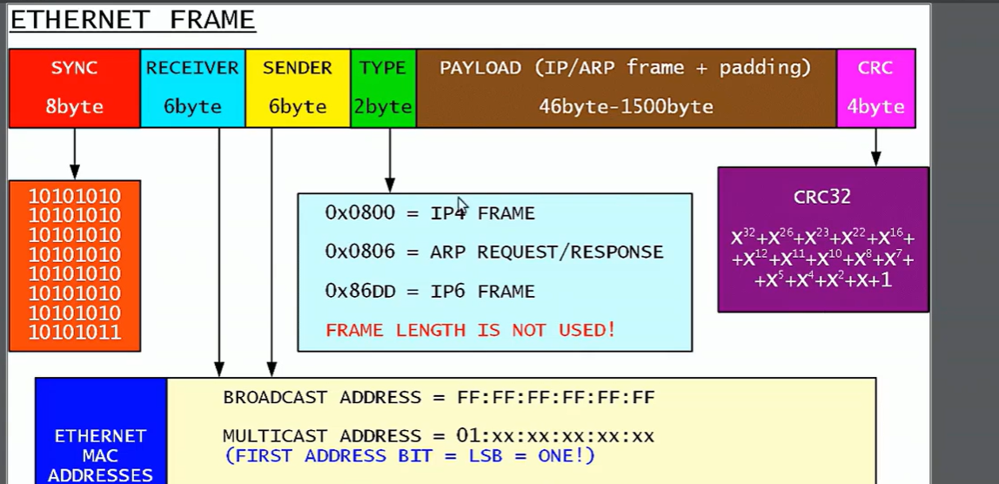

| Field | Purpose |
|---|---|
| Preamble/Sync | Synchronizes timing between sender and receiver |
| Destination MAC | Hardware address of the receiving device |
| Source MAC | Hardware address of the sending device |
| Type/Protocol | Indicates the encapsulated protocol (e.g., IPv4) |
| Payload | The actual encapsulated data (e.g., IP packet) |
| Frame Check Sequence | Error-checking to confirm correct data reception |

### 2.2 IPv4 Header Structure

The IPv4 header (always **20 bytes**) precedes the actual IP payload and contains: version, header length, time to live (TTL), protocol number, source IP, and destination IP. The **protocol number** field tells the program what type of data is nested inside:

| Protocol Number | Protocol |
|---|---|
| 1 | ICMP |
| 6 | TCP |
| 17 | UDP |

### 2.3 Key Technical Concepts Used Throughout

- **`struct.unpack()`** — converts raw binary data into usable Python values, based on a format string describing the byte layout.
- **Network byte order (`!`)** — data is stored differently in a computer's memory than how it is transmitted across a network (big-endian vs little-endian), so `!` is used in every `struct.unpack()` call to ensure correct interpretation across systems.
- **Format specifiers** — `B` (1-byte unsigned), `H` (2-byte unsigned short), `L` (4-byte unsigned long), `s` (byte string of given length), `x` (skip a byte).
- **Bitwise operations** — used whenever multiple pieces of information are packed into a single byte or chunk (e.g., IP version + header length in one byte; TCP offset + reserved bits + flags in one 16-bit value):
  - **Right shift (`>>`)** discards lower bits, isolating higher-order bits.
  - **AND (`&`)** isolates specific bits by comparing against a bitmask.

---

## 3. Implementation

### 3.1 Unpacking the Ethernet Frame

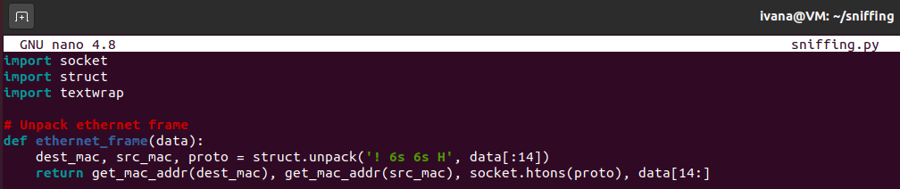

The first 14 bytes of any captured frame contain the destination MAC (6 bytes), source MAC (6 bytes), and protocol type (2 bytes). `data[:14]` slices out this header; `struct.unpack('! 6s 6s H', ...)` extracts the three fields. `socket.htons(proto)` converts the protocol value to the correct byte order. `data[14:]` returns everything after the header — the encapsulated IP packet.

### 3.2 Formatting the MAC Address

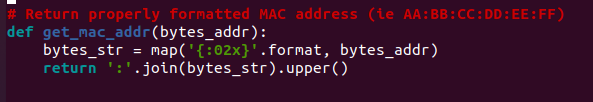

Raw MAC address bytes are converted into the standard human-readable format. `map()` applies `'{:02x}'.format` to every byte, converting it into a two-digit hexadecimal string. These are joined with colons and converted to uppercase, producing addresses like `AA:BB:CC:DD:EE:FF`.

### 3.3 Main Function and Raw Socket Setup

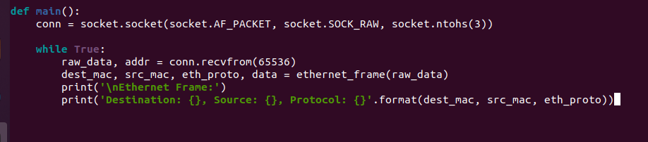

- `socket.AF_PACKET` allows access at the link (Ethernet) layer, capturing raw frames.
- `socket.SOCK_RAW` receives unprocessed packets exactly as they appear on the wire.
- `socket.ntohs(3)` sets the protocol to capture **all** traffic types.
- The `while True:` loop runs indefinitely, listening for packets. `conn.recvfrom(65536)` reads incoming data (65536 bytes is the maximum possible packet size, ensuring nothing is truncated).
- Each captured frame is passed into `ethernet_frame()`, and the extracted destination MAC, source MAC, and protocol are printed to confirm the pipeline works.

### 3.4 Unpacking the IPv4 Packet

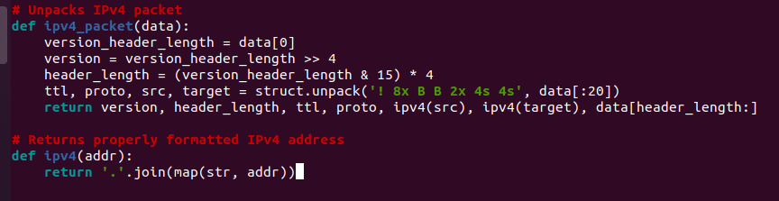

The first byte of the IP header packs both **version** and **header length** together. Right-shifting by 4 bits (`>> 4`) isolates the version; ANDing with `15` (`& 15`) isolates the header length value, which is then multiplied by 4 to get the actual length in bytes — this tells the program exactly where the header ends and the payload begins. `struct.unpack()` then extracts TTL, protocol number, source IP, and destination IP from the first 20 bytes, skipping irrelevant bytes with `x`. The `ipv4()` helper converts the raw 4-byte IP address into standard dotted-decimal notation (e.g., `192.168.1.1`).

### 3.5 Unpacking ICMP, TCP, and UDP

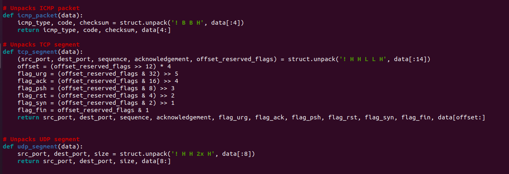

Once the IP protocol number is known, the correct function unpacks the transport-layer segment:

- **ICMP** (protocol 1) — a simple 4-byte header: type, code, checksum. Used for network diagnostics (e.g., `ping`).
- **TCP** (protocol 6) — the most common protocol for internet traffic. Its 14-byte header includes source/destination ports, sequence and acknowledgment numbers, and a combined 16-bit field holding the **data offset** and **six control flags** (URG, ACK, PSH, RST, SYN, FIN). Since these are packed together, bitwise shifting and ANDing are used to separate each flag individually — SYN and FIN specifically mark the start and end of a TCP connection (the "3-way handshake").
- **UDP** (protocol 17) — a simpler, connectionless protocol with just source port, destination port, and length in its 8-byte header (commonly used for DNS requests).

### 3.6 Formatting Multi-Line Data

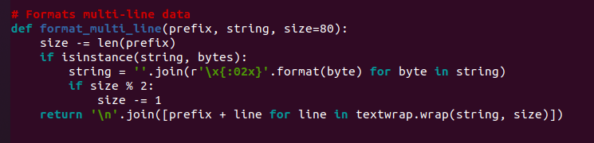

Raw payload data (e.g., an HTTP request) can be extremely long, so this function wraps it across multiple lines for readability. Byte data is converted into hexadecimal escape format (`\xNN`), then split into lines of a fixed width using `textwrap.wrap()`, with each line prefixed by the appropriate indentation level.

### 3.7 Indentation Constants

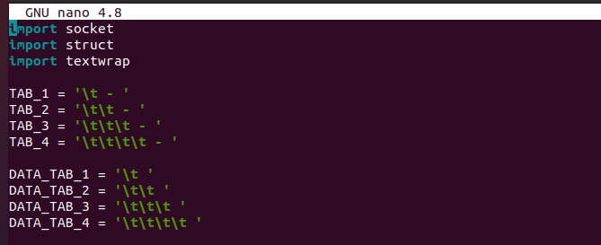

Since captured data is nested (Ethernet → IPv4 → ICMP/TCP/UDP → payload), these constants define increasing tab-indentation levels used when printing, so the output visually reflects the encapsulation structure — making it easier for a human to read.

### 3.8 Displaying the Complete Packet Structure

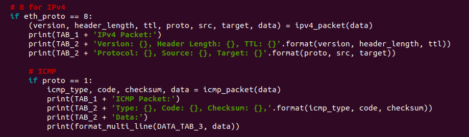

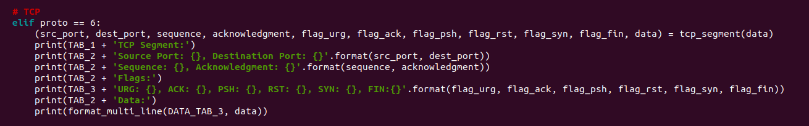

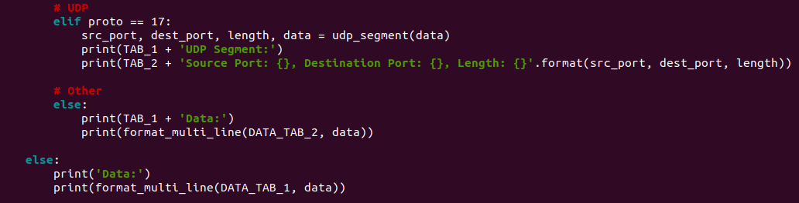

The Ethernet protocol field is first checked (`eth_proto == 8` confirms IPv4 traffic); if true, the IP header is unpacked and displayed. The IP protocol number is then checked to determine whether to call the ICMP, TCP, or UDP unpacking function — each branch prints its extracted fields with progressively deeper indentation. An `else` branch at each level handles unexpected protocol types gracefully by printing the raw remaining data instead of failing.

---

## 4. Testing and Output

The complete script was executed with **root/administrator privileges** (required for raw socket access) while generating live network traffic (e.g., loading a webpage in a browser, or running `ping`). The output confirms correct end-to-end functionality — each captured packet is displayed as a nested structure: Ethernet Frame containing an IPv4 Packet, containing a TCP Segment (or ICMP/UDP), containing the final payload Data.

This nested, indented output mirrors the real encapsulation structure of network data.

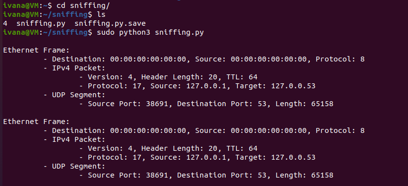
*Running `sudo python3 sniffing.py` — captured frames show a UDP Segment (Source Port 38691, Destination Port 53, Length 65158) nested inside an IPv4 Packet inside an Ethernet Frame.*

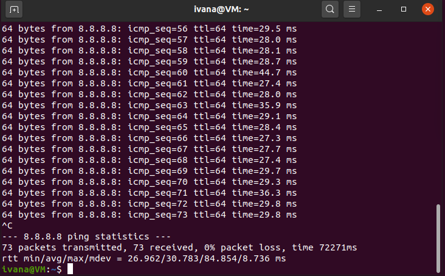
*Generating live ICMP traffic with `ping 8.8.8.8` to produce packets for the sniffer to capture.*

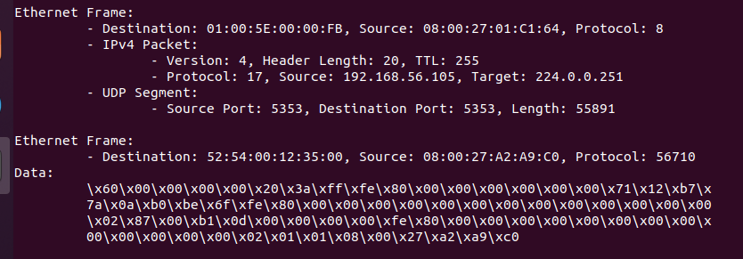
*Captured output showing a multicast UDP Segment (mDNS, port 5353) as well as a frame with an unrecognized protocol falling through to raw hex-escaped Data.*

---

## 5. Conclusion

This lab demonstrated how to build a functional packet sniffer in Python using raw sockets. Starting from the lowest layer (Ethernet frame) and progressively unpacking each encapsulated layer (IPv4 → ICMP/TCP/UDP → payload), the program successfully captures live network traffic and presents it in a clean, human-readable, indentation-based format. Key techniques applied include binary data parsing with `struct.unpack()`, byte-order handling for network compatibility, and bitwise operations to extract individually packed fields such as IP header length and TCP control flags.

---

## 6. Source Code

```python
import socket
import struct
import textwrap

TAB_1 = '\t - '
TAB_2 = '\t\t - '
TAB_3 = '\t\t\t - '
TAB_4 = '\t\t\t\t - '
DATA_TAB_1 = '\t '
DATA_TAB_2 = '\t\t '
DATA_TAB_3 = '\t\t\t '
DATA_TAB_4 = '\t\t\t\t '

def main():
    conn = socket.socket(socket.AF_PACKET, socket.SOCK_RAW, socket.ntohs(3))
    while True:
        raw_data, addr = conn.recvfrom(65536)
        dest_mac, src_mac, eth_proto, data = ethernet_frame(raw_data)
        print('\nEthernet Frame:')
        print(TAB_1 + 'Destination: {}, Source: {}, Protocol: {}'.format(dest_mac, src_mac, eth_proto))

        # 8 for IPv4
        if eth_proto == 8:
            (version, header_length, ttl, proto, src, target, data) = ipv4_packet(data)
            print(TAB_1 + 'IPv4 Packet:')
            print(TAB_2 + 'Version: {}, Header Length: {}, TTL: {}'.format(version, header_length, ttl))
            print(TAB_2 + 'Protocol: {}, Source: {}, Target: {}'.format(proto, src, target))

            # ICMP
            if proto == 1:
                icmp_type, code, checksum, data = icmp_packet(data)
                print(TAB_1 + 'ICMP Packet:')
                print(TAB_2 + 'Type: {}, Code: {}, Checksum: {},'.format(icmp_type, code, checksum))
                print(TAB_2 + 'Data:')
                print(format_multi_line(DATA_TAB_3, data))

            # TCP
            elif proto == 6:
                (src_port, dest_port, sequence, acknowledgment, flag_urg, flag_ack,
                 flag_psh, flag_rst, flag_syn, flag_fin, data) = tcp_segment(data)
                print(TAB_1 + 'TCP Segment:')
                print(TAB_2 + 'Source Port: {}, Destination Port: {}'.format(src_port, dest_port))
                print(TAB_2 + 'Sequence: {}, Acknowledgment: {}'.format(sequence, acknowledgment))
                print(TAB_2 + 'Flags:')
                print(TAB_3 + 'URG: {}, ACK: {}, PSH: {}, RST: {}, SYN: {}, FIN:{}'.format(
                    flag_urg, flag_ack, flag_psh, flag_rst, flag_syn, flag_fin))
                print(TAB_2 + 'Data:')
                print(format_multi_line(DATA_TAB_3, data))

            # UDP
            elif proto == 17:
                src_port, dest_port, length, data = udp_segment(data)
                print(TAB_1 + 'UDP Segment:')
                print(TAB_2 + 'Source Port: {}, Destination Port: {}, Length: {}'.format(
                    src_port, dest_port, length))

            # Other
            else:
                print(TAB_1 + 'Data:')
                print(format_multi_line(DATA_TAB_2, data))
        else:
            print('Data:')
            print(format_multi_line(DATA_TAB_1, data))


# Unpacks ethernet frame
def ethernet_frame(data):
    dest_mac, src_mac, proto = struct.unpack('! 6s 6s H', data[:14])
    return get_mac_addr(dest_mac), get_mac_addr(src_mac), socket.htons(proto), data[14:]


# Returns properly formatted MAC address (ie AA:BB:CC:DD:EE:FF)
def get_mac_addr(bytes_addr):
    bytes_str = map('{:02x}'.format, bytes_addr)
    return ':'.join(bytes_str).upper()


# Unpacks IPv4 packet
def ipv4_packet(data):
    version_header_length = data[0]
    version = version_header_length >> 4
    header_length = (version_header_length & 15) * 4
    ttl, proto, src, target = struct.unpack('! 8x B B 2x 4s 4s', data[:20])
    return version, header_length, ttl, proto, ipv4(src), ipv4(target), data[header_length:]


# Returns properly formatted IPv4 address
def ipv4(addr):
    return '.'.join(map(str, addr))


# Unpacks ICMP packet
def icmp_packet(data):
    icmp_type, code, checksum = struct.unpack('! B B H', data[:4])
    return icmp_type, code, checksum, data[4:]


# Unpacks TCP segment
def tcp_segment(data):
    (src_port, dest_port, sequence, acknowledgement, offset_reserved_flags) = struct.unpack(
        '! H H L L H', data[:14])
    offset = (offset_reserved_flags >> 12) * 4
    flag_urg = (offset_reserved_flags & 32) >> 5
    flag_ack = (offset_reserved_flags & 16) >> 4
    flag_psh = (offset_reserved_flags & 8) >> 3
    flag_rst = (offset_reserved_flags & 4) >> 2
    flag_syn = (offset_reserved_flags & 2) >> 1
    flag_fin = offset_reserved_flags & 1
    return (src_port, dest_port, sequence, acknowledgement, flag_urg, flag_ack,
            flag_psh, flag_rst, flag_syn, flag_fin, data[offset:])


# Unpacks UDP segment
def udp_segment(data):
    src_port, dest_port, size = struct.unpack('! H H 2x H', data[:8])
    return src_port, dest_port, size, data[8:]


# Formats multi-line data
def format_multi_line(prefix, string, size=80):
    size -= len(prefix)
    if isinstance(string, bytes):
        string = ''.join(r'\x{:02x}'.format(byte) for byte in string)
        if size % 2:
            size -= 1
    return '\n'.join([prefix + line for line in textwrap.wrap(string, size)])


main()
```

---

*Lab Report — Packet Sniffer | Network and Internet Security (CySE 228) | Department of Cyber Security Engineering, University of Frontier Technology, Bangladesh*
