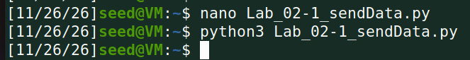
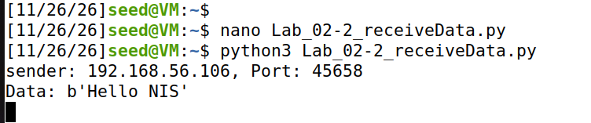

# Lab 02 — Sending and Receiving Data using Python Sockets (UDP)

*Network Security Lab Manual — VirtualBox (SEED Labs) + Python `socket` library*

---

## 1. Objective

This lab demonstrates the most basic form of network communication between two machines using Python's built-in `socket` library (no Scapy, no raw packets) — a UDP datagram is sent directly from one machine (**Sender**) to another (**Receiver**), which listens on a specific port and prints whatever it receives.

---

## 2. Lab Topology

Two virtual machines are used, connected to the same Host-only Network:

| Role | Example IP |
|---|---|
| Sender | `192.168.56.106` |
| Receiver | `192.168.56.107` (example — use your actual Receiver IP) |

> Replace the IP addresses with your own VMs' values. Find them on each VM with:
> ```bash
> ip a
> ```
> Look for the `enp0s8` interface and note its `inet` address.

---

## 3. Script Placement

| Script | Goes on |
|---|---|
| `Lab_02-1_sendData.py` | Sender |
| `Lab_02-2_receiveData.py` | Receiver |

---

## 4. Script Contents

### 4.1 Sender Script — `Lab_02-1_sendData.py`

```python
#!/usr/bin/env python3

# Imports Python's built-in socket library.
# This module provides low-level access to the
# operating system's networking interfaces (BSD socket API)
# so you can send and receive data over networks.
import socket

destIP = "192.168.56.107"   # Receiver's actual IP address
destPORT = 9090
data = b'Hello NIS'

# socket.AF_INET: Tells Python to use IPv4 addressing.
# socket.SOCK_DGRAM: Specifies Datagram Socket, (uses UDP)
# TCP (SOCK_STREAM)
sockt = socket.socket(socket.AF_INET, socket.SOCK_DGRAM)

# Sends the byte payload (data) directly to the specified destination
# sendto() does not wait to confirm
sockt.sendto(data, (destIP, destPORT))
```

**Edit before running:** `destIP` must be set to the Receiver's actual IP address.

### 4.2 Receiver Script — `Lab_02-2_receiveData.py`

```python
#!/usr/bin/env python3

import socket

# Any source
sourceIP = "0.0.0.0"

# port number to listen for incoming traffic.
myPORT = 9090

sockt = socket.socket(socket.AF_INET, socket.SOCK_DGRAM)

# Attaches the socket to address 0.0.0.0:9090
sockt.bind((sourceIP, myPORT))

# 1024: Sets the buffer size, to read up to 1,024 bytes of data at a time
while True:
    data, (sourceIP, sourcePORT) = sockt.recvfrom(1024)
    print("sender: {}, Port: {}".format(sourceIP, sourcePORT))
    print("Data: {}".format(data))
```

No edits needed — `0.0.0.0` means it listens for traffic arriving on any interface.

---

## 5. Running the Lab

### Step 1 — Start the Receiver first

On the Receiver VM:

```bash
python3 Lab_02-2_receiveData.py
```

> No `sudo` required — this is a regular UDP socket, not a raw socket.

It will sit silently, waiting for incoming data.

### Step 2 — Send data from the Sender

On the Sender VM:

```bash
python3 Lab_02-1_sendData.py
```


*Sender terminal — the script has no `print()` statements, so it returns to the prompt immediately after sending.*

### Step 3 — Check the Receiver's terminal


*Receiver terminal: `sender: 192.168.56.106, Port: 45658` followed by `Data: b'Hello NIS'` — confirming the UDP datagram was received successfully.*

---

## 6. Result

The Sender successfully transmitted a UDP datagram containing the payload `Hello NIS` directly to the Receiver's IP and port, using nothing but Python's standard `socket` library. The Receiver's listening socket captured the datagram and printed the sender's IP address, the sender's (ephemeral) source port, and the exact payload — confirming basic UDP client/server communication works correctly between the two VMs.

---

## 7. Troubleshooting

| Problem | Likely Cause | Fix |
|---|---|---|
| Receiver gets nothing | Wrong IP set in `destIP` | Re-check the Receiver's IP with `ip a` |
| Receiver gets nothing | VMs on different networks | Confirm both VMs use the same Host-only/Internal Network adapter |
| `OSError: [Errno 98] Address already in use` | An earlier receiver script is still running in another terminal | Press `Ctrl+C` in that terminal to stop it, then rerun |
| Nothing arrives even though `ping` works | Firewall blocking the UDP port | On the Receiver: `sudo ufw allow 9090/udp` (if ufw is enabled) |
| Want to confirm traffic is physically arriving | — | On the Receiver: `sudo tcpdump -i enp0s8 udp port 9090 -n` |

---

## 8. Key Takeaway

This lab establishes the foundation for the later sniffing and spoofing labs: a simple UDP client (`sendto()`) and server (`bind()` + `recvfrom()`) built entirely with Python's standard `socket` module, with no special privileges or raw socket access required. Later labs (03 and 04) build on this same send/receive pattern while introducing Scapy for crafting raw packets, sniffing traffic not addressed to a host, and performing ARP spoofing / MITM attacks.

---

*Prepared for academic lab submission — Sending and Receiving Data using Python Sockets (Lab 02).*
