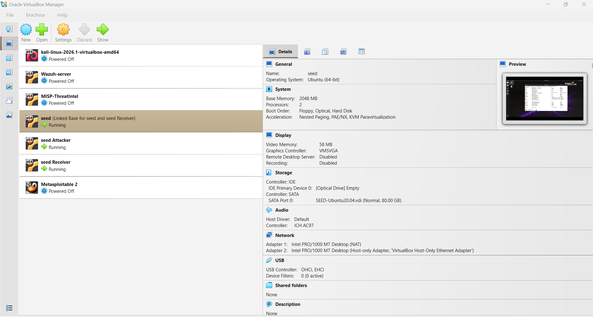
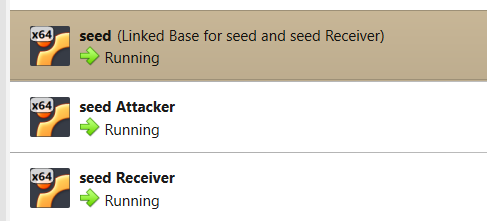
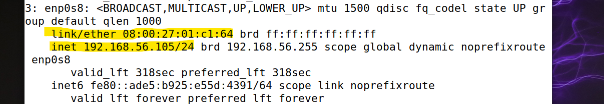
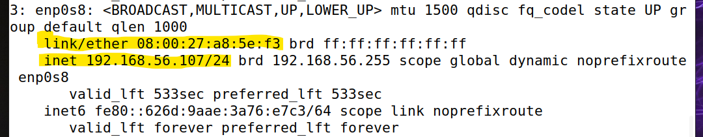
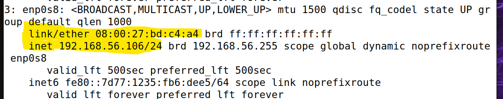
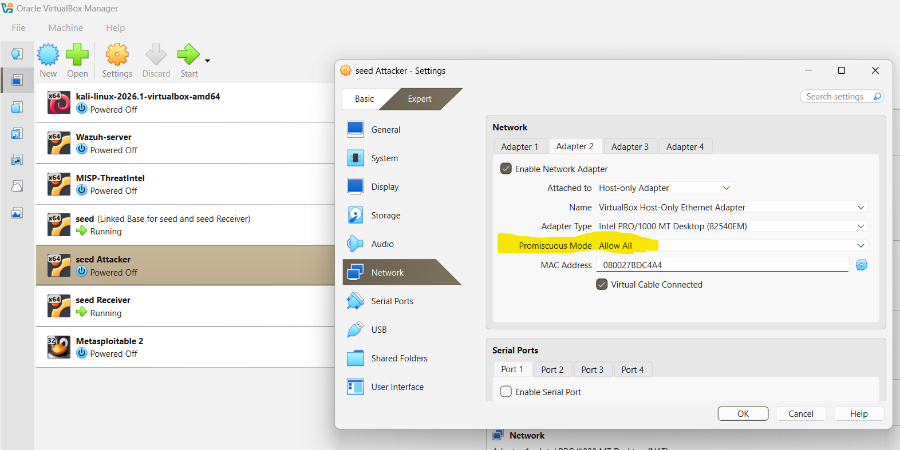
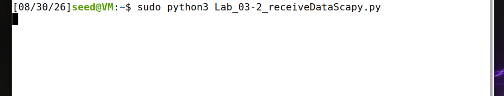
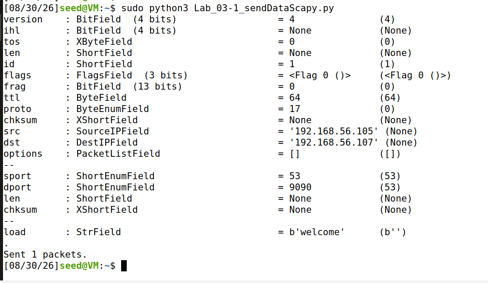
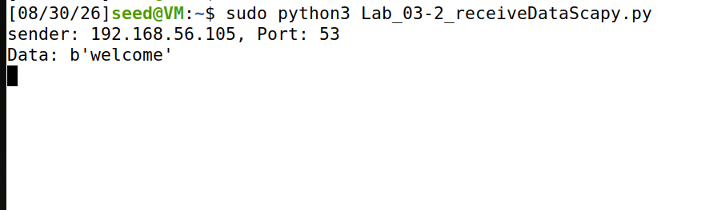
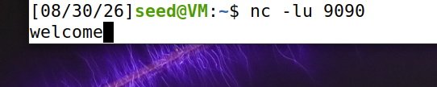

# Lab 03 — Sniffing Data using Scapy

*Network Security Lab Manual — VirtualBox (SEED Labs) + Python Scapy*

---

## 1. Objective

In this lab, one virtual machine (**Sender**) sends a raw UDP packet containing data to another virtual machine (**Receiver**) using the Scapy library. A third virtual machine (**Attacker**) silently listens on the same network and captures (sniffs) that data — even though the packet was never addressed to it. This demonstrates why unencrypted traffic on a shared network is never truly private.

---

## 2. Lab Topology

Three VirtualBox virtual machines are used, all connected to the same **Host-only Network** so that traffic between any two of them is visible on that network segment:

| Role | VM Name | IP Address | MAC Address |
|---|---|---|---|
| Sender (Machine A) | seed (base) | `192.168.56.105` | `08:00:27:01:c1:64` |
| Attacker | seed Attacker | `192.168.56.106` | `08:00:27:bd:c4:a4` |
| Receiver (Machine B) | seed Receiver | `192.168.56.107` | `08:00:27:a8:5e:f3` |

All three VMs are powered on for this lab, as shown below:


*Screenshot 1 — VirtualBox Manager: seed (base/Sender), seed Attacker, and seed Receiver all Running*


*Screenshot 2 — Close-up view confirming all three VMs are Running*

---

## 3. Finding IP and MAC Addresses

On each VM, open a terminal and run:

```bash
ip a
```

Locate the `enp0s8` interface (the Host-only network adapter) and note its IP address (`inet`) and MAC address (`link/ether`).

### 3.1 Sender (seed base) — 192.168.56.105


*Screenshot 3 — Sender's `ip a` output: link/ether 08:00:27:01:c1:64, inet 192.168.56.105*

### 3.2 Receiver (seed Receiver) — 192.168.56.107


*Screenshot 4 — Receiver's `ip a` output: link/ether 08:00:27:a8:5e:f3, inet 192.168.56.107*

### 3.3 Attacker (seed Attacker) — 192.168.56.106


*Screenshot 5 — Attacker's `ip a` output: link/ether 08:00:27:bd:c4:a4, inet 192.168.56.106*

---

## 4. Enabling Promiscuous Mode on the Attacker

By default, VirtualBox's virtual network switch blocks a VM from seeing traffic that is not addressed to it. Since the Attacker must capture traffic meant for the Receiver, **Promiscuous Mode** must be enabled on the Attacker VM's network adapter.

1. Shut down the **seed Attacker** VM.
2. In VirtualBox Manager, select **seed Attacker → Settings → Network → Adapter 2** (Host-only Adapter).
3. Set **"Promiscuous Mode"** to **"Allow All"**.
4. Click **OK** and start the VM again.


*Screenshot 6 — seed Attacker → Settings → Network: Promiscuous Mode set to "Allow All"*

---

## 5. Script Placement

| Script | Goes on |
|---|---|
| `Lab_03-1_sendDataScapy.py` | Sender (seed base) |
| `Lab_03-2_receiveDataScapy.py` | Attacker (seed Attacker) |

---

## 6. Script Contents

### 6.1 Sender Script — `Lab_03-1_sendDataScapy.py`

```python
#!/usr/bin/env python3

from scapy.all import IP, UDP, send, ls

DEST_IP = "192.168.56.107"     # Receiver's IP address
DEST_PORT = 9090
data = b'welcome'

# Stack Layer 3 (IP), Layer 4 (UDP), and Payload together
pkt = IP(dst=DEST_IP) / UDP(dport=DEST_PORT) / data

ls(pkt)

# Send the packet at Layer 3
send(pkt, iface='enp0s8')
```

**Edit before running:** `DEST_IP` must be the Receiver's actual IP address (`192.168.56.107`).

### 6.2 Sniffer Script — `Lab_03-2_receiveDataScapy.py`

```python
#!/usr/bin/env python3

from scapy.all import *

# Target Machine B's (Receiver's) actual MAC address
tm_MAC = '08:00:27:a8:5e:f3'

def process_packet(pkt):
    # Ignore frames not explicitly addressed to Machine B (or broadcast)
    if pkt.haslayer(Ether) and pkt[Ether].dst != tm_MAC and pkt[Ether].dst != 'ff:ff:ff:ff:ff:ff':
        return

    # Verify the packet contains IP and UDP layers
    if pkt.haslayer(IP) and pkt.haslayer(UDP):
        ip_src = pkt[IP].src
        port_src = pkt[UDP].sport

        # Extract payload bytes if present
        if pkt.haslayer(Raw):
            data = pkt[Raw].load
        else:
            data = bytes(pkt[UDP].payload)
        print("sender: {}, Port: {}".format(ip_src, port_src))
        print("Data: {}".format(data))

# Sniff incoming UDP packets targeting port 9090
sniff(iface="enp0s8", filter="udp port 9090", prn=process_packet, store=0)
```

**Edit before running:** `tm_MAC` must be the Receiver's actual MAC address (`08:00:27:a8:5e:f3`) — not the Attacker's own MAC.

---

## 7. Running the Lab

### Step 1 — Start the sniffer on the Attacker

On the Attacker VM terminal, run the sniffer first so it is ready and waiting before any data is sent:

```bash
sudo python3 Lab_03-2_receiveDataScapy.py
```


*Screenshot 7 — Attacker running the sniffer script, waiting silently for traffic*

### Step 2 — (Optional) Listen on the Receiver with netcat

To independently confirm what the Receiver actually gets, open netcat on the Receiver VM:

```bash
nc -lu 9090
```


*Screenshot 8 — Receiver listening with netcat on UDP port 9090*

### Step 3 — Send the data from the Sender

On the Sender VM terminal, run:

```bash
sudo python3 Lab_03-1_sendDataScapy.py
```

This prints the packet structure (from `ls(pkt)`) and then sends it:


*Screenshot 9 — Sender terminal: `ls(pkt)` field breakdown and "Sent 1 packets."*

### Step 4 — Check the Attacker's captured output

Back on the Attacker terminal, the sniffer should now print the intercepted data:


*Screenshot 10 — Attacker terminal: `sender: 192.168.56.105, Port: 53` | `Data: b'welcome'`*

### Step 5 — Check the Receiver's terminal

On the Receiver's netcat terminal, the same data has arrived normally:


*Screenshot 11 — Receiver terminal (netcat) showing the received text "welcome"*

---

## 8. Result

The Sender's packet (payload: `welcome`) was delivered normally to the Receiver, and was simultaneously captured by the Attacker — a machine that was never the intended recipient. This confirms that sniffing was successful: the Attacker was able to silently observe IP `192.168.56.105` as the sender, port `53`, and the exact data (`b'welcome'`) without either the Sender or Receiver being aware.

---

## 9. Troubleshooting

| Problem | Likely Cause | Fix |
|---|---|---|
| Attacker sees nothing | Promiscuous Mode disabled on the Attacker adapter | Enable "Allow All" as shown in Section 4 |
| Attacker sees nothing | Wrong interface name used in the script | Run `ip a` again and confirm the interface is `enp0s8` |
| Attacker sees nothing | VMs are on different networks | Confirm all three VMs use the same Host-only Adapter |
| Unsure if traffic is arriving at all | — | Run `sudo tcpdump -i enp0s8 udp port 9090 -n` on the Attacker to verify packets physically arrive |

---

## 10. Key Takeaway

Sniffing demonstrates that any device on the same local network segment can potentially observe traffic that is not addressed to it, especially when Promiscuous Mode is enabled and traffic is unencrypted. This is why encryption (e.g., TLS) is essential for protecting data in transit — Scapy simply reads whatever bytes appear on the wire, with no ability to see anything an encryption layer would have hidden.

---

*Prepared for academic lab submission — Sniffing using Scapy (Lab 03).*
